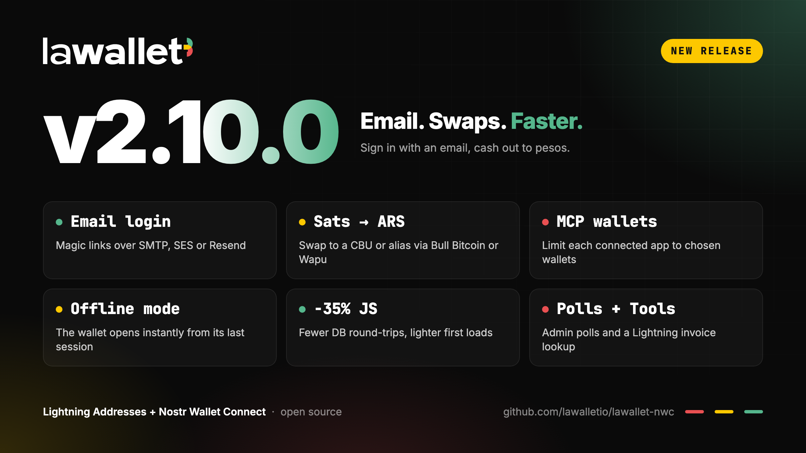

# v2.10.0

## Release date

2026-11-23

## Summary

Members can now **sign in with just an email address** (#401). An unknown
address gets a new account with a server-held key, a known one signs in, and
the claim dialog on the landing page offers every login method and picks the
claim back up after the magic link (#403). Operators configure SMTP, AWS SES or
Resend side by side under Settings ▸ Infrastructure ▸ Email.

**Integrations and swaps** arrive (#404, #405): with Bull Bitcoin or Wapu
enabled, any user can sell sats for Argentine pesos paid to a CBU, CVU or alias.
A three-step wizard quotes each provider, a status cron follows every order to
the end, and completed Bull Bitcoin orders get a PDF receipt. Admins also get a
**Tools** page with a Lightning invoice lookup (#406) and **preference polls**
that users answer from the wallet (#408).

MCP apps can be limited to **chosen wallets** per connection (#409), and Claude
Code and other MCP clients no longer lose their session on token refresh
(#415, #420).

The wallet opens instantly from its **last session** and shows an "Offline
mode" badge when the API can't be reached (#383). Card taps answer the
terminal as soon as the balance covers the invoice (#385, #388). A wallet that
may hold funds is never archived automatically again (#389). A performance pass
cut database round-trips on payment and balance paths, added missing indexes,
and shrank first-load JavaScript by up to 35% (#417, #418). It also removed
about 10,000 lines of dead code (#419).

## Heads-up before upgrading

### Card scans advertise a fixed ceiling (#388)

`GET /api/cards/[id]/scan` no longer reads the wallet balance. A spendable card
now always advertises up to **10,000,000 sats**, and an empty wallet refuses the
payment at the callback instead of advertising `0–0` up front. Blocked,
disabled, unpaired and receive-only cards still advertise `0–0`.

### Card taps can answer `OK` before settlement (#385)

When the paying wallet's balance is larger than the invoice, the callback
returns `OK` right away and finishes the payment in the background (LUD-03
allows async payment). The callback body may carry a `balance` field (msats)
when the owner shares it. Owners can turn this off with **Show balance at
checkout** in wallet card settings.

### Key vault falls back to `JWT_SECRET` (#402)

Email login needs a key vault. When `KEY_VAULT_SECRET` is unset, the vault key
is now derived from `JWT_SECRET`. While you rely on that fallback, **don't
rotate `JWT_SECRET`**: set `KEY_VAULT_SECRET` first, then rotating is safe.
Keys stored under the fallback stay readable after you add it. The Umbrel and
Start9 packages already set `KEY_VAULT_SECRET`.

### MCP access tokens last 24 hours (#420)

OAuth access tokens now live 24 hours (was 1 hour), and a rotated refresh token
can be replayed for an hour. Tokens are still checked against their grant on
every call, so revoking an app takes effect immediately.

### Optional shared rate limiting (#416, #421, #422)

| Variable                                    | Purpose                                                               |
| ------------------------------------------- | --------------------------------------------------------------------- |
| `UPSTASH_REDIS_URL` / `UPSTASH_REDIS_TOKEN` | Share API rate-limit counters across serverless instances             |
| `KV_REST_API_URL` / `KV_REST_API_TOKEN`     | Same, under the names the Vercel Marketplace Upstash integration uses |
| `SWAP_RECONCILE_INTERVAL_MS` (listener)     | How often the listener ticks swap reconciliation, default 1 minute    |
| `SWAP_RECONCILE_MAX_INTERVAL_MS` (listener) | Longest gap while no swap is in flight, default 5 minutes             |

All are optional. Set both values of a pair or neither. The URL must be the
https REST URL. Single-instance installs (Umbrel, Start9, Docker) stay on the
in-memory limiter, which is exact for one web instance.

### Duplicate SDK packages removed (#419)

`packages/sdk` and `packages/react` are gone from this repository. The
maintained client is [`@lawallet/sdk`](https://github.com/lawalletio/sdk).

## Highlights

### Sign-in

- feat(web): email magic-link login + multi-provider email (SMTP/SES/Resend) (#401)
- feat(web): claim dialog offers every login method + resumes claim after email link (#403)
- fix(web): fall back to JWT_SECRET for the key vault (#402)

### Integrations and swaps

- feat(web): third-party integrations + Lightning→ARS swaps (#404)
- feat(web): swap status cron, Bull Bitcoin PDF receipts, suggestion auto-advance (#405)
- fix(web): expire Wapu swaps at the order deadline, not the invoice's (#410)
- feat(web): wallet balances in swap Pay from + staggered row fade-in for all tables (#413)

### Admin

- feat(web): admin Tools page with Lightning invoice lookup + users-list name fallback (#406)
- feat(web): user preference polls — API, admin dashboard, USDT tech poll (#408)

### MCP and connected apps

- feat(web): per-connection wallet access for MCP apps (#409)
- fix(oauth): idempotent refresh-token rotation with a grace window (#415)
- fix(oauth): stop MCP clients losing their session on refresh (#420)
- fix(web): MCP client setup snippets + Claude Code scope/stale-URL docs (#407)

### Wallet

- feat(wallet): local-first cache with an offline mode badge (#383)
- fix(wallet): never auto-archive a wallet that may hold funds (#389)
- feat(wallet): suggest wapupay.com and obelisk.ar lightning domains (#398)
- feat(web): unwrap LNURL from a `lightning` query param when scanning (#399)

### Cards

- perf(cards): answer BoltCard taps before settlement, pin functions to iad1 (#385)
- perf(cards): advertise a fixed 10M-sat ceiling on scan, skip the balance read (#388)

### Performance

- perf(db): cut round-trips on payment, balance and wallet hot paths + indexes (#417)
- perf(web): lazy-load modals + xyflow, pause hidden-tab polling, trim re-renders (#418)
- feat(web): optional Upstash Redis backend for the API rate limiter (#416)
- perf(rate-limit): 2 Upstash commands per check + read Vercel KV env names (#421)
- fix(config): pick the Upstash URL and token as a pair (#422)
- perf(nwc): skip the direct relay retry after a listener wallet timeout (#391)
- perf(profiles): don't block on relays for a pubkey known to have no profile (#393)

### Observability

- feat(listener): ship pino logs + sampled traces to Sentry (#396)
- fix(web): Sentry cleanup — dependency source maps, pino logs, payment-pending noise (#397)
- fix(lncurl): report LNCurl mint failures to Sentry (#392)

### Platform

- Dependency upgrades + Sentry-driven perf: zap sweep backoff, LUD-21 verify, pg pool (#412)
- chore: remove dead code, duplicate SDK packages and unused assets (#419)
- fix(backup): export invoices with BigInt amountMsats + name the failing table (#400)
- chore(deps): ignore withdrawn picomatch advisory in pnpm audit (#411)
- docs(changelog): v2.9.0 release image + reusable renderer (#382)
- chore: bump version to 2.9.1 (#384)

## Upgrading

No manual database steps: migrations run on start. They are additive (email
login, swaps, polls, OAuth wallet access, card balance sharing, wallet balance
memory) plus new indexes. On a large `Invoice` table the index rebuild can make
the first start take a little longer. Redeploy the listener with the web app:
it now drives the swap status ticks.

Umbrel and Start9 packages are bumped by automation once the images publish.
