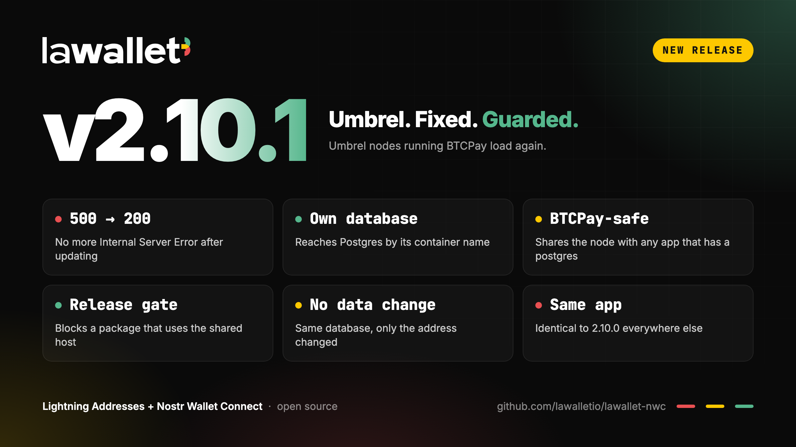

# v2.10.1

## Release date

2026-11-24

## Summary

A fix for Umbrel nodes that also run another app with a database service
named `postgres`, such as **BTCPay Server**. After updating to 2.10.0 those
nodes answered every page with `Internal Server Error`.

Every Umbrel app shares one Docker network, so the package's bare `postgres`
host also resolved to the other app's database, and Docker DNS alternated
between the two. Any connection that landed on the wrong one failed with
`role "lawallet" does not exist`. When that happened during startup, the web
app could not serve anything. The bug was in the package all along; the
2.10.0 update only exposed it by restarting the app.

The Umbrel package now reaches its database by its own container name,
`lawallet-nwc_postgres_1`, as it already did for the listener
(lawalletio/umbrel-app-store#61). The release gate now fails if the package
ever goes back to the shared name.

There are no app code changes. On Docker, StartOS and Vercel, 2.10.1 is the
same as 2.10.0.

## Highlights

### Deployment

- fix(umbrel): reach Postgres by its container name, not the shared `postgres` alias (lawalletio/umbrel-app-store#61)
- chore(deploy-check): fail the release if the Umbrel package uses the shared `postgres` host

## Upgrading

Update from the Umbrel App Store. No data changes: the database is the same,
only the address the app uses to reach it changed.
